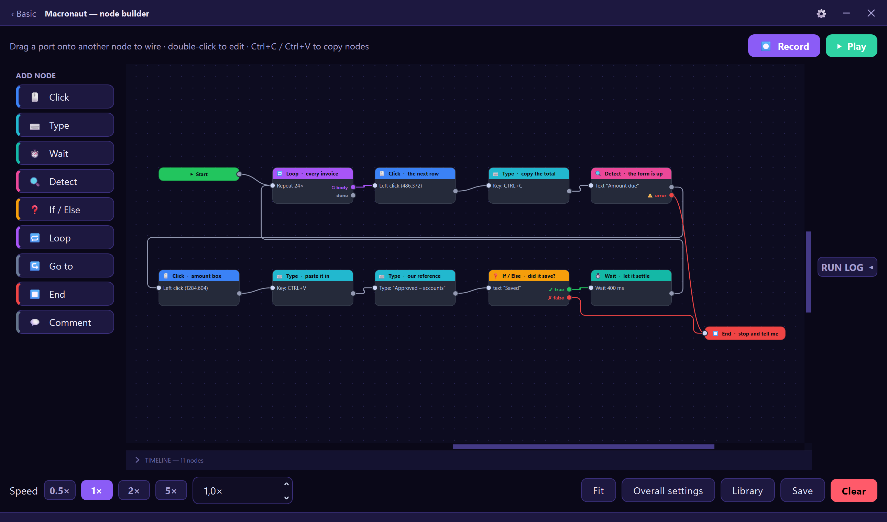
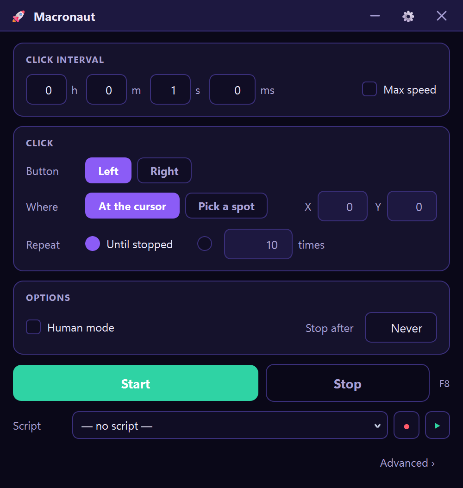

<h1 align="center">Macronaut: free auto clicker and visual macro recorder for Windows</h1>

<p align="center"><b>An open-source auto clicker that watches the screen and decides what to do.</b><br>
Record your clicks and keystrokes, or draw a script: wait for something to
appear, click it where it actually is, and keep going when it doesn't. In any
Windows app, without writing code.</p>

<p align="center"><b>English</b> · <a href="docs/README.fr.md">Français</a> · <a href="docs/README.de.md">Deutsch</a> · <a href="docs/README.es.md">Español</a></p>

<p align="center">
  <a href="https://github.com/gtjevptje/Macronaut/releases/latest"></a>
  <a href="https://github.com/gtjevptje/Macronaut/releases/latest"></a>
  <a href="https://github.com/gtjevptje/Macronaut/releases"></a>
  
  <a href="https://github.com/gtjevptje/Macronaut/actions/workflows/tests.yml"></a>
  <a href="LICENSE"></a>
</p>

<h3 align="center">
  <a href="https://github.com/gtjevptje/Macronaut/releases/latest/download/Macronaut.exe">⬇&nbsp;&nbsp;Download Macronaut for Windows</a>
  <br><sub>Windows shows <b>“Windows protected your PC”</b> on first run —
  click <b>More info → Run anyway</b>. It does that for any unsigned app.</sub>
</h3>

<p align="center"><i>One 78 MB file. No installer, no account, no Python.
It updates itself.</i></p>

<p align="center"><a href="https://gtjevptje.github.io/Macronaut/"><b>macronaut website →</b></a></p>

<p align="center"><sub>Free, and made by one person. If Macronaut is useful to
you, a ⭐ on this repository is what helps other people find it.</sub></p>

<p align="center"></p>

## The first two minutes

1. **It opens as a plain auto-clicker.** Interval, button, how many times, where.
   Press Start. If that is all you came for, you are finished on this screen.
2. **5 scripts are already in the library** — a clicker that stops
   after a set number of clicks, one that clicks every 30 seconds to keep a
   session awake, one that types a block of text. Open one and press Play.
   Nothing to set up first.
3. **Advanced is one click away**, and it is a canvas: boxes for the things it
   does, wires for the order. Record yourself and it lands there as editable
   steps, or draw it yourself.

## What it does that a plain auto clicker cannot

**It waits for something, then clicks where that thing actually is.**
Point it at a button, a dialog or an icon. It searches the screen until that
appears — at a different DPI or window size too — and clicks it where it found
it, not at a coordinate that was right yesterday. Text works the same way, read
with Windows' own OCR, and so does a single pixel changing colour.

**It decides.** Every detection has a *found* branch and a *not found* branch,
so a script can handle the dialog that never appeared instead of hammering the
spot where it should have been. With loops and jumps to go with it.

**Keyboard and mouse in one script.** Clicks, keystrokes, chords, drags, scroll
flicks and held keys, in whatever order you need them — hold **W** to keep
moving while the mouse clicks, and everything is released when the run ends,
stops or crashes.

**It reaches programs that ignore ordinary input.** Three selectable input
backends: standard, SendInput scancodes, and the **Interception** kernel driver.
Many games discard injected input; the lower two look like a real keyboard to
them.

---

## The two faces

Macronaut automates clicking, typing and waiting in **any** Windows program —
including ones with no API, no scripting support and no plugins. It opens on
whichever face you closed it on, and each remembers its own size and position:
Basic parked in a corner beside the window it is clicking, Advanced as big as
you like.

<p align="center"></p>

If you have ever thought *"I do this exact thing twenty times a day"*, that
is the thing Macronaut is for.

Coming from another tool? There are honest comparisons — each one saying what
the other still does better, because there is always something:
[**vs AutoHotkey**](https://gtjevptje.github.io/Macronaut/autohotkey-alternative.html) if you have been
meaning to learn it for a year, and
[**vs TinyTask**](https://gtjevptje.github.io/Macronaut/tinytask-alternative.html) if you have re-recorded
the same clicks three times because a window moved.

Just want the clicker? [**The auto clicker page**](https://gtjevptje.github.io/Macronaut/auto-clicker.html)
covers setting one up, choosing an interval, and the two things nobody explains:
why antivirus complains about every tool in this category, and how you stop the
thing once it is running. There is also a
[**click speed test**](https://gtjevptje.github.io/Macronaut/click-speed-test.html) — no ads, no sign-up,
runs in the page.

## Free, all of it

No trial, no watermark, no account, no advertising, and no limit on what a
script can do. Every feature on this page is in the download.

## What it can do

**Just click something, over and over** *(the Basic face)*
- Interval in hours / minutes / seconds / milliseconds, or **Max** for as fast
  as the machine will go
- Left or right button, at the cursor or at a fixed X·Y you can pick off screen
- Repeat a set number of times, until you stop it, or until a stop-after timer
  runs out
- Human mode jitters the cursor so the movement is not machine-perfect
- Start and Stop, plus the same global hotkey the rest of the app uses

**Build a script visually** *(the Advanced face)*
- Drop in **Click**, **Move**, **Drag**, **Scroll**, **Type text**, **Key press**,
  **Wait**, **Comment**, **Detect**, **If / Else**, **Loop** and **Go to**
- Wire them together and press ▶ — the running step lights up as it goes
- Group a region with a **comment box**; drag the box and everything on it moves
- Colour-code nodes, bend wires around each other, jump between sections
- Copy, paste, duplicate and bulk-edit across the whole script or just a selection

**React to what's on screen**
- **Find an image** — wait for a button, a dialog or an icon to appear, then click it
- **Read text** — wait until specific words show up, using Windows' built-in OCR
- **Check a pixel** — the cheapest possible "is the panel open yet?"
- Every detection has a **✓ true** and a **✗ false** branch, so a script can handle
  the case where the thing never appears

**Record instead of build**
- Hit ⏺ and work normally — clicks, keystrokes, chords, scroll flicks and
  click-and-drag gestures all land on the canvas as editable nodes
- Held keys stay held; a swipe is recorded as a swipe, not as a click

**Hold keys down**
- Press and release are separate actions, so a script can hold **W** to keep moving
  while it clicks with the mouse
- Anything still held is always released when the run ends, stops or crashes

**Run it your way**
- Global start/stop hotkey that works while another window is focused
- Bind **different scripts to different keys** — one keypress launches one script
- Playback speed multiplier, loop counts, per-step delays
- Timing estimates and a run timeline, measured on your machine rather than guessed

**Reach programs that ignore normal input**
- Three selectable input backends: standard, **SendInput scancodes**, and the
  **Interception** kernel driver
- Some programs — games especially — discard ordinary injected input. The lower
  backends look like a real keyboard to them.

**Stays out of the way**
- Single 78 MB `.exe`, no installer, no Python, no admin needed to run
- Checks for updates and applies them on restart, verified by SHA-256
- Always-on-top mode, system tray icon, dark and light themes
- Light when idle: about 0.1% of one CPU core while it sits waiting (measured on 2.3.5)

## Questions people ask

### I just want an auto-clicker. Do I have to learn the node thing?

No. Macronaut opens on Basic, which is [a plain auto-clicker](https://gtjevptje.github.io/Macronaut/auto-clicker.html): set the interval, pick a button, choose how many times, press Start. No nodes, no wires, no diagram. The canvas is behind an Advanced link if you ever want it, and Macronaut reopens on whichever of the two you closed it on. Basic is free, permanently.

### Is it really free?

Yes, all of it. There is no trial, no watermark, no account, no advertising and no limit on what a script can do. Nothing expires and nothing nags you.

### Do I have to build everything myself?

No. It arrives with 5 automations already built and waiting in the library — an auto-clicker, a clicker that stops after a set number of clicks, one that clicks once every 30 seconds to keep a session awake, one that types a block of text for you, and one that presses a key over and over. None of them need setting up: open one and press Play. Each carries a note on the canvas saying what it does and which part to change.

### How is this different from AutoHotkey?

AutoHotkey is a scripting language, and a good one — if you are willing to learn it. Macronaut is the same idea without the code: you record what you do, or drag steps onto a canvas and wire them together. The trade is real. AutoHotkey will do things Macronaut cannot; Macronaut you can use this afternoon. There is [a side-by-side comparison](https://gtjevptje.github.io/Macronaut/autohotkey-alternative.html), including what AutoHotkey still does better.

### Will it work in a game?

Often, yes — but read the warning further down this page first, because many online games ban automation and can ban your account for it. Technically: some games ignore ordinary injected input, so Macronaut has three input backends, the lowest of which is a kernel driver that looks like a real keyboard. If one does not work, switch to the next.

### Does it need an internet connection?

Only to check for updates, which you can turn off. Automations run entirely on your machine, and there is no account to sign in to.

### Can I use it on more than one computer?

Yes, on as many as you like. There is nothing to activate and nothing that counts machines.

### Why does Windows say it is unsafe?

Because it is not code-signed yet. SmartScreen warns about any new executable it has not seen before, signed or not, and a signing certificate has both a real cost and a procurement lead time. Click “More info” then “Run anyway”. Antivirus software is also occasionally suspicious of anything that sends keystrokes, which is unavoidable for a tool whose entire job is sending keystrokes. If you would rather not take that on trust, the source is public and you can build the .exe yourself — see the next answer.

### Is Macronaut open source?

Yes, all of it, under the GNU GPL v3. Every line that goes into the download is on GitHub: the input backends, the update checker, the lot. You can read it, change it, and share what you change. You can build it yourself too, with “pyinstaller macronaut.spec” — though your .exe will not be byte-identical to this one. PyInstaller stamps a timestamp into its output and does not order its archive deterministically, so two builds from the same tree on the same machine differ. That means a hash comparison against this download will never match, and that is PyInstaller rather than evidence of anything. What is checkable is the source — all of it — and the SHA-256 published under the download button, which tells you the file you got is the file that was published.

## Privacy

Macronaut has no accounts and no telemetry. Automations run entirely on your
machine. The one thing that ever leaves
your computer is a crash report, and only if you opt in; those carry the error,
the version, your Windows version and which step was running, never your
scripts, your keystrokes, anything on screen, or your name.

The [full privacy policy](https://gtjevptje.github.io/Macronaut/privacy.html) says exactly what is in a
crash report, what is stripped out of it before it is written to disk, and how
to have one deleted.

## Requirements

Windows 10 or 11, 64-bit. Nothing else — everything is inside the `.exe`.

> **On first run, Windows may warn you.** Macronaut is not code-signed yet, so
> SmartScreen shows *"Windows protected your PC"* for new downloads. Click
> **More info → Run anyway**. You do not have to take my word for what is in
> the file:
> [the source is public](https://github.com/gtjevptje/Macronaut), and `pyinstaller src/macronaut.spec`
> builds the program from it. Your build will not have the same SHA-256 as the
> download — PyInstaller stamps timestamps into its output, so no two builds
> match byte for byte, not even two of mine. What you can check is that nothing
> goes into the `.exe` that is not in this repository.

## A word of warning

Macronaut sends real keyboard and mouse input. **Many online games and services
forbid automation in their terms of service, and using it against them can cost
you your account.** That is your call to make — read their rules first. There is
no warranty of any kind; see sections 15 and 16 of the
[licence](https://github.com/gtjevptje/Macronaut/blob/main/LICENSE).

## Build it from source

Everything that goes into the released `.exe` is in this repository. You need
Windows 10 or 11 and Python 3.12.

```powershell
git clone https://github.com/gtjevptje/Macronaut
cd Macronaut
pip install -r requirements.txt
python src/main.py                  # run it

pip install pytest
python -m pytest -q                 # the test suite

pip install pyinstaller
pyinstaller src/macronaut.spec          # builds dist\Macronaut.exe
```

Issues and pull requests are welcome. It is a one-person project, so replies
are not instant. [CONTRIBUTING.md](.github/CONTRIBUTING.md) covers getting set up,
running the suite, and the traps that have actually caught people. Security
bugs go to email rather than the issue tracker — [SECURITY.md](.github/SECURITY.md)
says what is in scope and, just as usefully, what is not.

The website is served from this repository's
[`gh-pages` branch](https://github.com/gtjevptje/Macronaut/tree/gh-pages). The history of the *program*
here starts with the release that moved its source into this repository;
before that it was published in a separate one. Nothing about the program is
withheld.

## Licence

**Free software, under the GNU General Public License v3.0 or later.**
Copyright © 2026 Gerben van Poucke. `SPDX-License-Identifier: GPL-3.0-or-later`

Run it, read it, change it, pass it on. The one obligation is that a modified
version you distribute — as source or as a built `.exe` — comes with its changes
published under the same licence.

**The complete source is this repository.** Macronaut was proprietary
until 30 August 2026, and the reason it is not any more is the paragraph above
this one: an unsigned executable that installs a global keyboard hook is asking
for a lot of trust, and publishing the code is the only answer to that which
does not ask for more. `pyinstaller src/macronaut.spec` builds it from that source.

⚠ **Which builds this covers.** Macronaut was proprietary until 30 August 2026.
Releases from **2.3.3 onward are GPL**; builds published before that date remain
under the EULA they shipped with, and relicensing does not reach backwards into
copies already downloaded. The `LICENSE` file in this repository is the licence
of what is here now.

The licence and the
[third-party notices](https://github.com/gtjevptje/Macronaut/blob/main/docs/THIRD-PARTY-NOTICES.md) also ship
inside the app, under **Settings → About & legal**, next to a link back to the
source.

## Getting in touch

**[gerbenvanpoucke0@gmail.com](mailto:gerbenvanpoucke0@gmail.com)** — bug reports. It is one person, not a ticket queue.

---

<p align="center">
  <a href="https://github.com/gtjevptje/Macronaut/releases/latest/download/Macronaut.exe"><b>⬇&nbsp;&nbsp;Download Macronaut for Windows</b></a>
</p>
