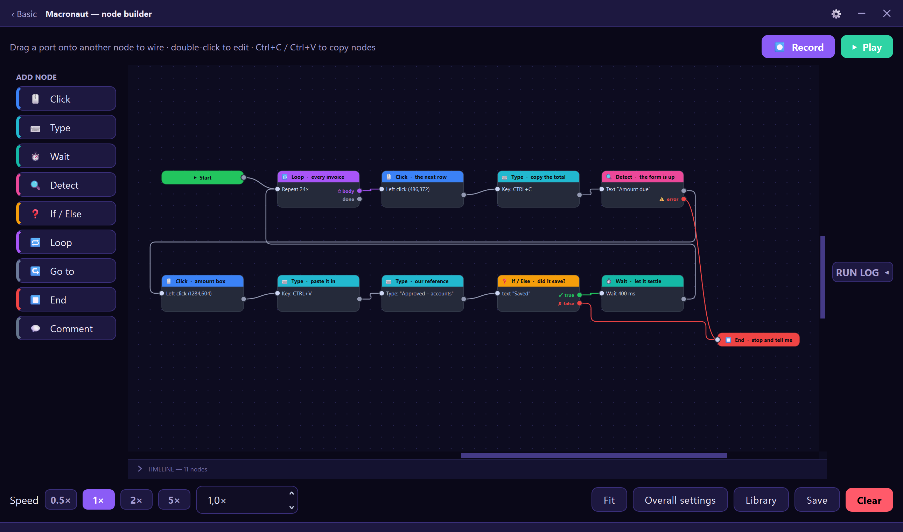

<h1 align="center">Macronaut: kostenloser Auto Clicker und Makro-Rekorder für Windows</h1>

<a href="../README.md">English</a> · <a href="README.fr.md">Français</a> · <b>Deutsch</b> · <a href="README.es.md">Español</a>

<b>Ein Open-Source-Auto-Clicker, der den Bildschirm beobachtet und entscheidet, was zu tun ist.</b> 
Zeichne deine Klicks und Tastendrücke auf oder baue ein Skript: warten, bis
etwas erscheint, es dort anklicken, wo es wirklich ist, und weitermachen, wenn
es nicht erscheint. In jedem Windows-Programm, ohne Code zu schreiben.

<h3 align="center">
  <a href="https://github.com/gtjevptje/Macronaut/releases/latest/download/Macronaut.exe">⬇&nbsp;&nbsp;Macronaut für Windows herunterladen</a>
   Beim ersten Start zeigt Windows <b>„Der Computer wurde durch Windows geschützt“</b>:
  klicke auf <b>Weitere Informationen → Trotzdem ausführen</b>.
  Das macht Windows bei jeder nicht signierten Anwendung.
</h3>

<i>Eine einzige Datei. Keine Installation, kein Konto, kein Python.
Aktualisiert sich selbst.</i>

> **Die Anwendung selbst ist auf Englisch.** Diese Seite ist eine übersetzte
> Zusammenfassung; maßgeblich ist das [vollständige englische README](../README.md).

## Was es kann

- **Ein einfacher Auto Clicker.** Intervall, Maustaste, Anzahl der
  Wiederholungen, Position. Auf Start drücken, fertig.
- **Ein Makro-Rekorder.** Klicks, Tasten, Scrollen und Ziehen aufzeichnen:
  alles landet als Schritte, die du bearbeiten kannst.
- **Es beobachtet den Bildschirm.** Auf ein Bild, einen Text (gelesen mit der
  Windows-eigenen OCR) oder eine Pixelfarbe warten und dann dort klicken, wo es
  gefunden wurde, nicht an einer Koordinate, die gestern gestimmt hat.
- **Es entscheidet.** Jede Erkennung hat einen Zweig „gefunden“ und einen Zweig
  „nicht gefunden“, dazu Schleifen und Sprünge.
- **Tastatur und Maus in einem Skript.** Eine Taste gedrückt halten, während
  die Maus klickt; am Ende wird alles losgelassen.
- **Es erreicht Programme, die normale Eingaben ignorieren.** Drei wählbare
  Eingabewege, darunter ein Kernel-Treiber, den Spiele als echte Tastatur sehen.
- **Globaler Hotkey** zum Starten und Stoppen, und verschiedene Skripte auf
  verschiedenen Tasten.

## Kostenlos, und zwar alles

Keine Testversion, kein Wasserzeichen, kein Konto, keine Werbung und keine
Grenze dafür, was ein Skript tun kann.

## Häufige Fragen

### Ist es wirklich kostenlos?

Ja, alles. Nichts läuft ab und nichts nervt.

### Warum sagt Windows, es sei unsicher?

Weil die Datei noch nicht signiert ist. SmartScreen warnt bei jeder neuen
ausführbaren Datei, die es nicht kennt. Auch ein Virenscanner kann einem
Werkzeug misstrauen, dessen Aufgabe es ist, Tastendrücke zu senden. Du musst
mir das nicht glauben: der gesamte Quellcode liegt in diesem Repository.

### Funktioniert es in Spielen?

Oft ja. Lies aber zuerst die Warnung weiter unten.

### Ist es Open Source?

Ja, vollständig, unter der GNU GPL v3. Du kannst den Code lesen, ändern und
selbst bauen.

## Warnung

Macronaut sendet echte Tastatur- und Mauseingaben. **Viele Online-Spiele und
-Dienste verbieten Automatisierung in ihren Nutzungsbedingungen, und das kann
dich dein Konto kosten.** Lies vorher ihre Regeln. Es gibt keinerlei Garantie;
siehe die [Lizenz](../LICENSE).

## Ein Problem oder eine Idee?

[Öffne ein Issue](https://github.com/gtjevptje/Macronaut/issues/new/choose)
(am liebsten auf Englisch). Es ist das Projekt einer einzelnen Person.

Wenn Macronaut dir nützt, hilft ein ⭐ für dieses
Repository anderen, es zu finden.

  <a href="https://github.com/gtjevptje/Macronaut/releases/latest/download/Macronaut.exe"><b>⬇&nbsp;&nbsp;Macronaut für Windows herunterladen</b></a>
  &nbsp;·&nbsp; <a href="https://gtjevptje.github.io/Macronaut/">Website</a>
  &nbsp;·&nbsp; <a href="../README.md">Vollständiges README (Englisch)</a>

