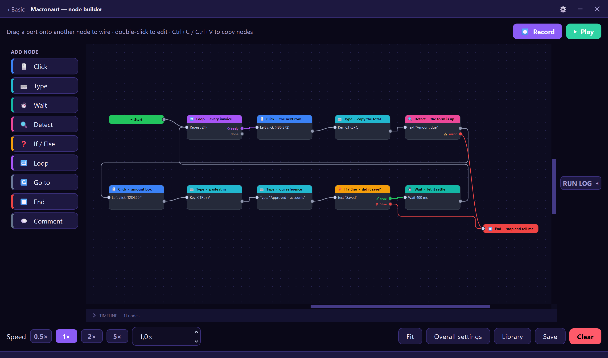

<h1 align="center">Macronaut: auto clicker gratis y grabador de macros para Windows</h1>

<a href="../README.md">English</a> · <a href="README.fr.md">Français</a> · <a href="README.de.md">Deutsch</a> · <b>Español</b>

<b>Un auto clicker de código abierto que mira la pantalla y decide qué hacer.</b> 
Graba tus clics y pulsaciones, o dibuja un script: esperar a que algo aparezca,
hacer clic donde realmente está y seguir adelante si no aparece. En cualquier
programa de Windows, sin escribir código.

<h3 align="center">
  <a href="https://github.com/gtjevptje/Macronaut/releases/latest/download/Macronaut.exe">⬇&nbsp;&nbsp;Descargar Macronaut para Windows</a>
   La primera vez, Windows muestra <b>«Windows protegió su PC»</b>:
  haz clic en <b>Más información → Ejecutar de todas formas</b>.
  Windows hace eso con cualquier aplicación sin firmar.
</h3>

<i>Un solo archivo. Sin instalación, sin cuenta, sin Python.
Se actualiza solo.</i>

> **La aplicación en sí está en inglés.** Esta página es un resumen traducido;
> la referencia es el [README completo en inglés](../README.md).

## Qué hace

- **Un auto clicker sencillo.** Intervalo, botón del ratón, número de
  repeticiones, posición. Pulsa Start y listo.
- **Un grabador de macros.** Graba clics, teclas, desplazamiento y arrastres:
  todo queda como pasos que puedes editar.
- **Mira la pantalla.** Espera una imagen, un texto (leído con el OCR de
  Windows) o el color de un píxel, y haz clic donde se encontró, no en una
  coordenada que ayer era correcta.
- **Decide.** Cada detección tiene una rama «encontrado» y otra «no
  encontrado», con bucles y saltos.
- **Teclado y ratón en el mismo script.** Mantén una tecla pulsada mientras el
  ratón hace clic; al terminar se suelta todo.
- **Llega a programas que ignoran la entrada normal.** Tres modos de envío a
  elegir, entre ellos un controlador de núcleo que los juegos ven como un
  teclado real.
- **Atajo global** para iniciar y detener, y scripts distintos en teclas
  distintas.

## Gratis, todo

Sin versión de prueba, sin marca de agua, sin cuenta, sin publicidad y sin
límite en lo que puede hacer un script.

## Preguntas frecuentes

### ¿De verdad es gratis?

Sí, todo. Nada caduca y nada te insiste.

### ¿Por qué Windows dice que no es seguro?

Porque el archivo todavía no está firmado. SmartScreen avisa ante cualquier
ejecutable nuevo que no conoce. Un antivirus también puede desconfiar de una
herramienta cuyo trabajo es enviar pulsaciones. No hace falta que me creas:
todo el código fuente está en este repositorio.

### ¿Funciona en juegos?

A menudo sí. Pero lee antes la advertencia de más abajo.

### ¿Es de código abierto?

Sí, por completo, bajo la licencia GNU GPL v3. Puedes leer el código,
modificarlo y compilarlo tú mismo.

## Advertencia

Macronaut envía entradas reales de teclado y ratón. **Muchos juegos y servicios
en línea prohíben la automatización en sus condiciones de uso, y puede costarte
la cuenta.** Lee antes sus normas. No hay garantía de ningún tipo; consulta la
[licencia](../LICENSE).

## ¿Un problema o una idea?

[Abre una incidencia](https://github.com/gtjevptje/Macronaut/issues/new/choose)
(mejor en inglés). Es el proyecto de una sola persona.

Si Macronaut te resulta útil, una ⭐ en este repositorio
ayuda a que otras personas lo encuentren.

  <a href="https://github.com/gtjevptje/Macronaut/releases/latest/download/Macronaut.exe"><b>⬇&nbsp;&nbsp;Descargar Macronaut para Windows</b></a>
  &nbsp;·&nbsp; <a href="https://gtjevptje.github.io/Macronaut/">Sitio web</a>
  &nbsp;·&nbsp; <a href="../README.md">README completo (inglés)</a>

