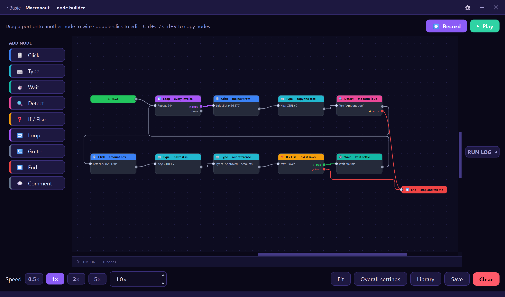

<h1 align="center">Macronaut : auto clicker gratuit et enregistreur de macros pour Windows</h1>

<a href="../README.md">English</a> · <b>Français</b> · <a href="README.de.md">Deutsch</a> · <a href="README.es.md">Español</a>

<b>Un auto clicker open source qui regarde l'écran et décide quoi faire.</b> 
Enregistrez vos clics et vos frappes, ou dessinez un script : attendre qu'un
élément apparaisse, cliquer là où il se trouve vraiment, et continuer s'il
n'apparaît pas. Dans n'importe quelle application Windows, sans écrire de code.

<h3 align="center">
  <a href="https://github.com/gtjevptje/Macronaut/releases/latest/download/Macronaut.exe">⬇&nbsp;&nbsp;Télécharger Macronaut pour Windows</a>
   Au premier lancement, Windows affiche <b>« Windows a protégé votre ordinateur »</b> :
  cliquez sur <b>Informations complémentaires → Exécuter quand même</b>.
  Windows fait cela pour toute application non signée.
</h3>

<i>Un seul fichier. Pas d'installation, pas de compte, pas de Python.
Il se met à jour tout seul.</i>

> **L'application elle-même est en anglais.** Cette page est un résumé traduit ;
> le [README anglais complet](../README.md) fait référence.

## Ce qu'il fait

- **Un auto clicker simple.** Intervalle, bouton de la souris, nombre de
  répétitions, position. Appuyez sur Start, c'est tout.
- **Un enregistreur de macros.** Enregistrez vos clics, vos touches, le
  défilement et les glisser-déposer : tout arrive sous forme d'étapes que vous
  pouvez modifier.
- **Il regarde l'écran.** Attendez une image, un texte (lu par l'OCR de Windows)
  ou la couleur d'un pixel, puis cliquez là où l'élément a été trouvé, pas à une
  coordonnée qui était juste hier.
- **Il décide.** Chaque détection a une branche « trouvé » et une branche « pas
  trouvé », avec des boucles et des sauts.
- **Clavier et souris dans le même script.** Maintenez une touche enfoncée
  pendant que la souris clique ; tout est relâché à la fin.
- **Il atteint les programmes qui ignorent les entrées ordinaires.** Trois modes
  d'envoi au choix, dont un pilote noyau que les jeux voient comme un vrai clavier.
- **Raccourci global** pour démarrer et arrêter, et des scripts différents sur
  des touches différentes.

## Gratuit, entièrement

Pas de version d'essai, pas de filigrane, pas de compte, pas de publicité et
aucune limite sur ce qu'un script peut faire.

## Questions fréquentes

### Est-ce vraiment gratuit ?

Oui, tout. Rien n'expire et rien ne vous relance.

### Pourquoi Windows dit-il que ce n'est pas sûr ?

Parce que le fichier n'est pas encore signé. SmartScreen avertit pour tout
nouvel exécutable qu'il ne connaît pas. Un antivirus peut aussi se méfier d'un
outil dont le travail est d'envoyer des frappes. Vous n'avez pas à me croire
sur parole : tout le code source est dans ce dépôt.

### Est-ce que ça marche dans un jeu ?

Souvent, oui. Mais lisez d'abord l'avertissement ci-dessous.

### Est-ce open source ?

Oui, entièrement, sous licence GNU GPL v3. Vous pouvez lire le code, le
modifier et le compiler vous-même.

## Avertissement

Macronaut envoie de vraies entrées clavier et souris. **Beaucoup de jeux et de
services en ligne interdisent l'automatisation dans leurs conditions
d'utilisation, et vous pouvez y perdre votre compte.** Lisez leurs règles avant.
Aucune garantie d'aucune sorte ; voir la [licence](../LICENSE).

## Un problème, une idée ?

[Ouvrez un ticket](https://github.com/gtjevptje/Macronaut/issues/new/choose)
(de préférence en anglais). C'est le projet d'une seule personne.

Si Macronaut vous est utile, une ⭐ sur ce dépôt aide
d'autres personnes à le trouver.

  <a href="https://github.com/gtjevptje/Macronaut/releases/latest/download/Macronaut.exe"><b>⬇&nbsp;&nbsp;Télécharger Macronaut pour Windows</b></a>
  &nbsp;·&nbsp; <a href="https://gtjevptje.github.io/Macronaut/">Site web</a>
  &nbsp;·&nbsp; <a href="../README.md">README complet (anglais)</a>

